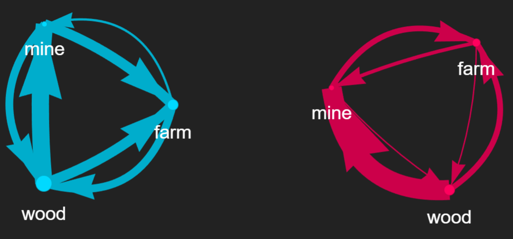
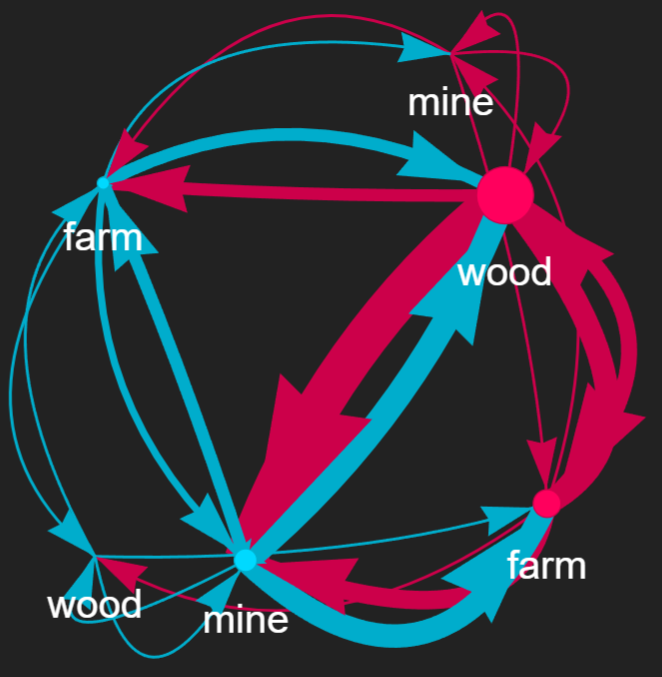

# Leontief_NeuralNetwork
## Description
Finds an optimised trade matrix in a multiregionional Leontief input-output model using an artificial neural network.

## Background

For isolated economies, the input-output model is described by:

$$ X = AX + D$$

where $X$ is a stacked vector of total demand and $D$ is final end-consumer demand from each sector in each region ($n_{sector} n_{region}\times 1$). $A$ is a block technology matrix containing $n_{region}^2$ submatrices $A_{ij}$ ($n_{sector}\times n_{sector}$). Only diagonal submatrices ($A_{ii}$) are non-zero. The columns of $A_{ii}$ are the represent domestic inputs required to produce a unit of output. $A$ and $D$ are known *a priori* in this model.

### Multiregional input-output model
When interregional trade is included, a simple approach to modelling resource redistribution is as follows:
$$ X = C(AX + D) $$
where the trade matrix $C$ ($n_{sector} n_{region}\times n_{sector} n_{region}$) is a Markov matrix that redistributes technology input requirements ($A$) and final demand ($D$) to sectors of other regions.

For each column $C_i$, all elements must be zero except those corresponding to the same sector across all regions ($C_{i,i}, C_{i,i+n_{sector}},...$). All columns sum to one.

### Artificial Neural Network
The artificial neural network nonlinearly transforms the non-zero elements of the trade matrix $C$, initialised with equal imports from all regions, to create a new matrix $C^*$ subject to the constraints above.

The loss function is the sum of total demand ($X$, converted to units of labour) required to meet the preassigned final demand ($D$) given the technology matrix ($A$):

$$ X^* = (I - C^*A)^{-1}C^*D$$
$$\text{Loss} = \text{Sum}(X^*_{\text{labour units}})$$

The gradient of the loss function is backpropagated through the ANN, and so the ANN is trained iteratively on the initial trade matrix to produce an optimised $C^*$.

### Visual output for two regions and three sectors:
Isolated economies:

Optimised multiregional trade:


## Instructions (LINUX)
Create new Python environment and activate it:
```
python -m venv new_env
source new_env/bin/activate
```
Download and install package and dependencies:
```
pip install git+https://github.com/CPWilsonProjects/Leontief_NeuraNetwork
```
Run `__main__.py`:
````
python -m Leontief_NeuralNetwork
````


## Requirements
Python >= 3.10

## Dependencies
torch >= 2.1.0

torchvision >= 0.16.0

pyvis == 0.3.1